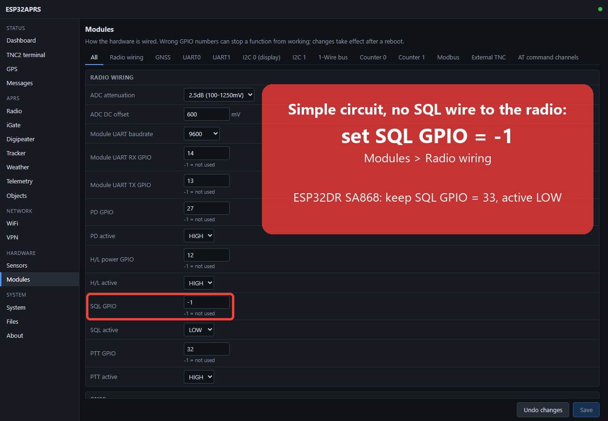
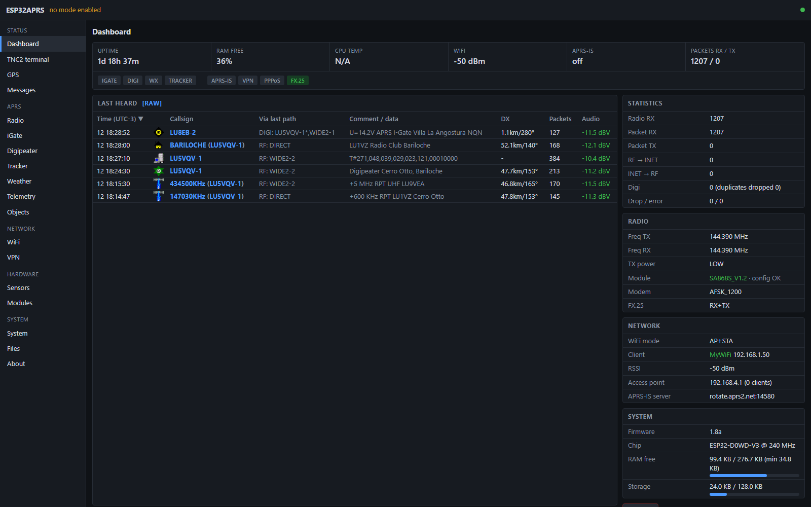
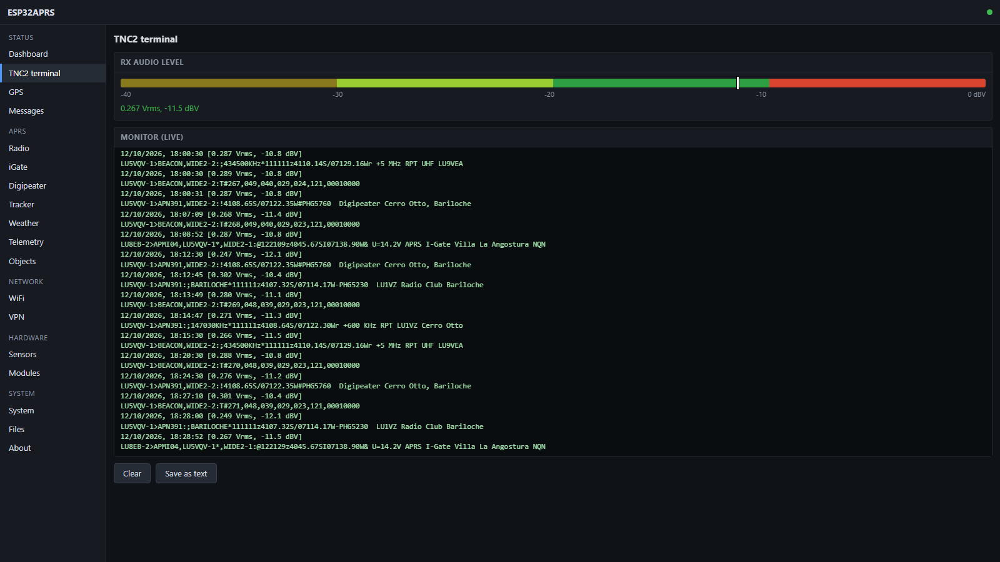
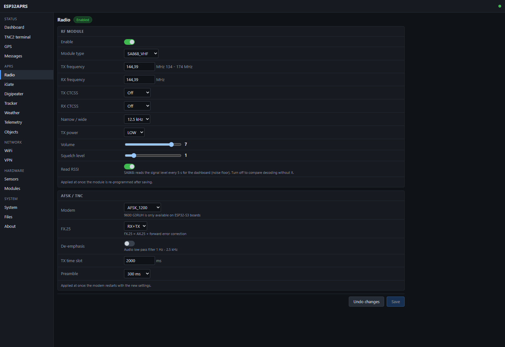
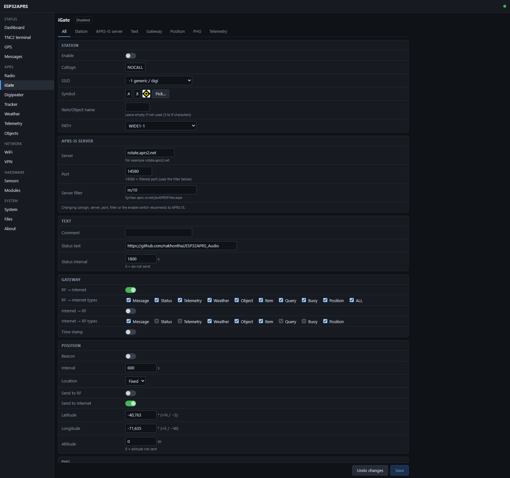
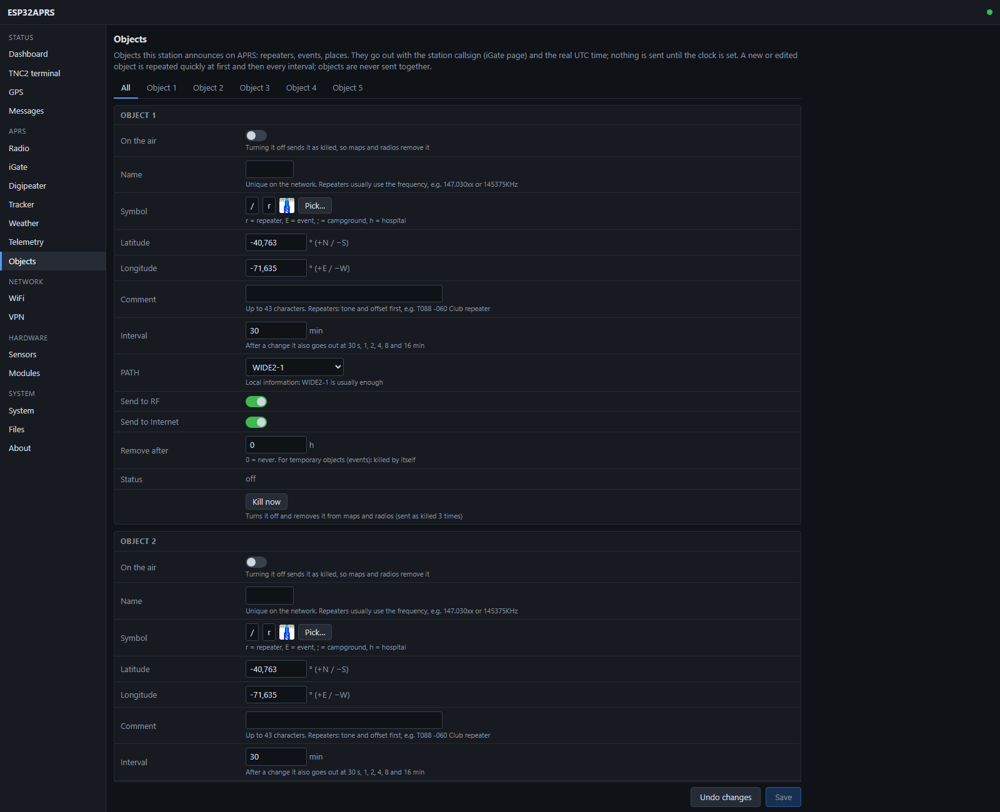
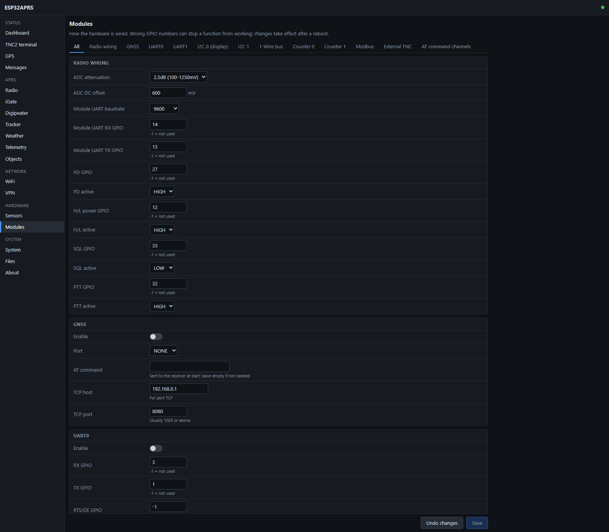
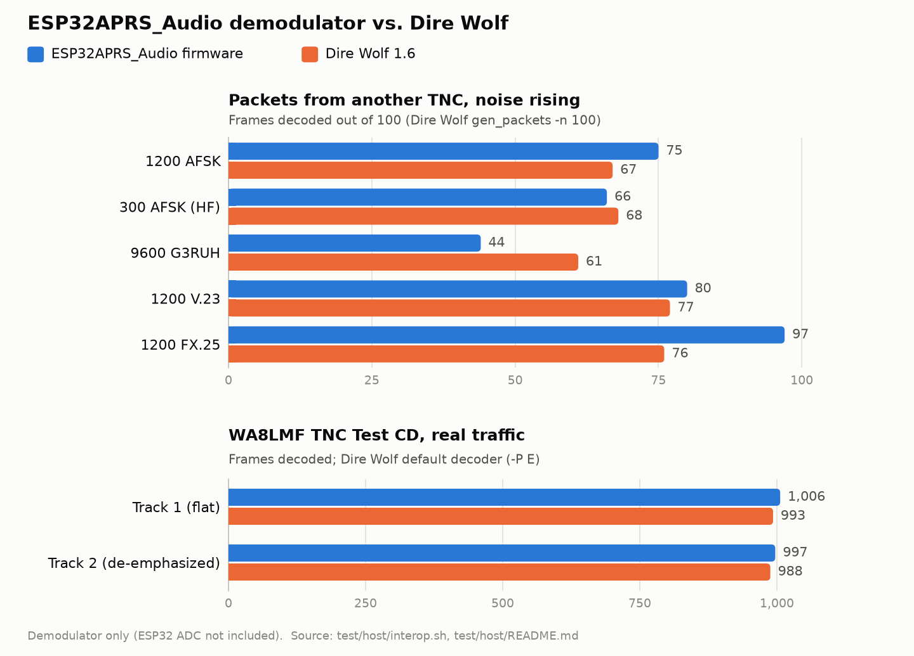

## Arduino core for the ESP32, ESP32-C3, ESP32-C6 and ESP32-S3

# ESP32APRS Audio(Speaker/Mic) Project

ESP32APRS Audio is a Internet Gateway(IGate)/Digital Repeater(DiGi)/Tracker/Weather(WX)/Telemetry(TLM) with AFSK/GFSK TNC Built in that is implemented for Espressif ESP32 processor.
 

## About this fork

This is a fork of [nakhonthai/ESP32APRS_Audio](https://github.com/nakhonthai/ESP32APRS_Audio) by HS5TQA,
maintained by Jonatan, LU6EWB. Its goal is a station that can run unattended for years (for example a digipeater
or iGate on a hilltop), at least as reliable as a dedicated TNC such as the Kantronics KPC-3+.

- **Based on:** upstream firmware V1.8, commit `9a41b72` (2026-07-12).
- **What changed:** see [Changes in this fork](#changes-in-this-fork) below.
- The original author's work and credits are kept.

## Feature

* Supported hardware: ESP32DR Simple,ESP32DR,D.I.Y Other
* Supported RF Module: SA8x8/FRS VHF/UHF/350 model
* Support APRS internet gateway (IGATE)
* Support APRS digital repeater (DIGI)
* Support APRS tracker (TRACKER)
* Support APRS Weather (WX)
* Support APRS telemetry (TLM)
* Support APRS Message (MSG)
* Support GNSS External mod select UART0-2 and TCP Client
* Support TNC External mod select UART0-2 and Yaesu packet
* Support APRS IGATE/DIGI/WX/Telemetry with fix position for move position from GNSS
* Using ESP-Arduino development on Visual studio code + Platform IO
* Implementing software modem, decoding and encoding
* Support monitor display information and statistices
* Support Wi-Fi multi station or WiFi Access point
* support Web Service config and control system
* support filter packet rx/tx on igate,digi,display
* support audio filter BPF,HPF
* support VPN wireguard
* support global time zone
* support web service auth login
* support BLUETOOTH SPP/BLE
* support PPPoS (PPP Over Serial GSM network)
* support MQTT
* support AT-Command config/ctl by channel UART,MSG,Bluetooth
* support Automatic REBOOT by interval time
* display received and transmit packet on the LED and display OLED or led color strip
* Multiple modems: credit coding from project [vp-digi](https://github.com/sq8vps/vp-digi)
  * 1200bps AFSK Bell 202 1200/2200Hz (VHF standard)
  * 300bps AFSK Bell 103 1600/1800Hz (HF standard)
  * 9600bps GFSK G3RUH (For ESP32-S3)
  * 1200bps AFSK V.23
* Analog-digital busy channel detection (data carrier detection)
* AX.25 coder/decoder
* FX.25 (AX.25 with error correction) coder/decoder, fully compatible with [Direwolf](https://github.com/wb2osz/direwolf) and [UZ7HO Soundmodem](http://uz7.ho.ua/packetradio.htm)
* APRS objects: up to 5 objects of the station (repeaters, events, places), with start-up decay and kill (this fork)
* Web interface rebuilt as a small offline app with a JSON API; works on phones (this fork)
* Task supervisor: restarts the station if a task, the RX audio or the main loop stops, and shows why (this fork)

## Hardware screen short
 
 


## Hardware mod

**SQL (squelch) pin.** The firmware samples the receive audio only while the radio's squelch is open, read on
*SQL GPIO* (Modules page, Radio wiring). If the radio's squelch output is **not wired** to the ESP32 (for example
the ESP32DR Simple circuit), set **SQL GPIO = -1**: the station then listens all the time and finds packets by the
audio level. With the pin set but not wired, the firmware reads a floating input and may never decode anything.

| Board | SQL GPIO |
|---|---|
| ESP32DR Simple (external radio by cable) | `-1` (not wired) |
| ESP32DR SA868 | `33`, active LOW (the module's AUDIO_ON output) |
| Other radio with its squelch output wired | the GPIO it is wired to |



## Web interface

The station is set up and watched from a web browser (computer or phone). Screenshots of the current interface,
taken on an ESP32DR SA868 board receiving the local APRS network:

**Dashboard** - last heard stations with their comment/data, distance and audio level, plus statistics, radio, network and system status.


**TNC2 terminal** - every packet decoded on RF, with the RX audio level meter used to set the receive level.


**Radio** - frequency, power and module settings.


**iGate** - station, APRS-IS server, gateway rules and position.


**Objects** - up to 5 objects of the station (repeaters, events, places).


**Modules** - how the hardware is wired (radio GPIOs, buses, GNSS, ports).


Decoding test with the original interface (WA8LMF TNC Test CD, track 1):


## ESP32DR_SA868
Share project [here](https://oshwlab.com/APRSTH/esp32sa818) \
Schematic [here](doc/ESP32DR_SA868/ESP32DR_SA868_sch.pdf) \
PCB Gerber [here](doc/ESP32DR_SA868/ESP32DR_SA868_Gerber.zip)

**RX audio level.** The board has two trimpots: **SPK** (receive audio from the SA868 to the ESP32 ADC) and **MIC**
(transmit audio, i.e. deviation). Set the receive level with **SPK** only: open *TNC2 terminal* and adjust until
packets show **-10 to -20 dBV** (green on the meter). Above -10 dBV the ADC clips and packets are lost; the decoder
needs at least 10 mV. Do not touch **MIC** to fix reception.

## ESP32DR Simple


ESP32DR Simple Circut is small interface board for connecting to a transceiver.

* PCB size is 64x58mm
* PCB Single size
* RJ11 6 Pin out to Radio

### Fix Audio input/output port
|ESP32 Core|ADC(Speaker)|DAC(Mic)|
|---|:---:|---|
|ESP32|GPIO36|GPIO26|
|ESP32-C3|GPIO0|GPIO1|
|ESP32-S3|GPIO1|GPIO2|

### Schematic
[](image/Schematic_ESPC3_APRS.png)

[](image/ESP32DR_SimpleCircuit.png)

### CAD data
 
The gerber data is [here](doc/Gerber_ESP32DR_Simple.zip)

The PCB film positive is [here](doc/PCB_Bottom.pdf)

The PCB film negative is [here](doc/PCB_Bottom_Invert.pdf)

The PCB Layout is [here](doc/PCB_Layout.pdf)

The ESP32DR_Simple Schematic PDF is [here](doc/ESP32DR_Simple_Schematic.pdf)

The ESP32C3APRS Schematic PDF is [here](doc/Schematic_ESPC3_APRS.pdf)

### BOM list  

|Reference|Value|Description|
|---|:---:|---|
|U1|ESP32 DEVKIT|DOIT ESP32 DEVKIT (โมดูล ESP32)|
|RP2|1K|VR 3362W (R ปรับค่าเสียงออก)|
|RP1|10K|VR 3362W (R ปรับค่าเสียงเข้า)|
|RJ11|RJ11-6P6C|แจ๊คโมดูล RJ11 แบบ 6ขา|
|R13,R12,R11,R5,R3,R9|1K|R 1K 1/4W (ค่าสี: น้ำตาล ดำ แดง)|
|R7,R18,R19|100R|R 100R  1/4W (ค่าสี: น้ำตาล ดำ ดำ)|
|R6,R2,R1|10K|R 10k  1/4W  (ค่าสี: น้ำตาล ดำ ส้ม)|
|R4|3K|R 3k 1/4W (ค่าสี: ส้ม ดำ แดง)|
|R10|33K|R 33K 1/4W (ค่าสี: ส้ม ส้ม ส้ม)|
|Q1|2N3904|ทรานซิสเตอร์ NPN (TO-92)|
|LED3|LED 3.5mm|สีเหลือง แสดงส่งสัญญาณ TX|
|LED2|LED 3.5mm|สีเขียว แสดงรับสัญญาณ RX|
|LED1|LED 3.5mm|สีแดง แสดงไฟเข้าทำงาน|
|L1|L or JMP|L Isolate or Jumper|
|C11|100uF/6.3V|ตัวเก็บประจุแบบอิเล็กโทรไลติก|
|C4,C5|100nF|ตัวเก็บประจุแบบเซรามิกมัลติเลเยอร์|
|C6|470uF/10V|ตัวเก็บประจุแบบอิเล็กโทรไลติก|
|C1,C3,C10|100nF หรือ 0.1uF|ตัวเก็บประจุแบบโพลีโพรไพลีน|
|C2|10nF หรือ 0.01uF|ตัวเก็บประจุแบบโพลีโพรไพลีน|
|D2,D1|1N4148|ไดโอด หรือใช้ C 0.01uF แทนได้|

*R18 and R19 ไม่ใส่ก็ได้.  
*D2,D1 เปลี่ยนเป็นตัวเก็บประจุแบบเซรามิกมัลติเลเยอร์ค่า 10nF แทนได้ 
*หากใช้ต่อกับวิทยุรับส่งเข้าขาไมค์นอก ให้เปลี่ยน R4 เป็น 100K

จัดซื้อชุดคิทผ่าน Shopee ได้ที่ [คลิ๊ก](https://shopee.co.th/product/45191268/13373396785)

The Howto DIY is [here](doc/ESP32DR_DIY-Thai.pdf)

### Mounting drawing


### Transceiver connection

Solder jumper is needed depending on a transceiver.


|Manufacture|RJ11-1 (+VIN)|RJ11-2 (SPK)|RJ11-3 (PTT)|RJ11-4 (GND)|RJ11-5 (MIC)|RJ11-6 (SQL)|
|---|---|---|---|---|---|---|
|Alinco DR-135(DB9)|-|2|7|5|9|1|
|IC2200(RJ45)|-|SP|4|5|6|-|
|FT-2800(RJ11)|-|SP|1|3|2|-|
|HT Mic Cable|-|SPK|PTT|GND|MIC|-|

for Alinco DR-135(DB9)


for ICOM IC2200(RJ45)


for Yaesu FT-2800(RJ11)


for Handheld


## ESP32APRS_Audio firmware installation (do it first time, next time via the web browser)
Ready-made firmware for every board is on the [Releases](https://github.com/ltiisidii/ESP32APRS_Audio/releases) page,
built by GitHub Actions from this repository: `<board>-full.bin` for the first install by USB (write it at 0x0) and
`<board>-update.bin` for later updates from the web page.

- 1.Connect the USB cable to the ESP32 Module.
- 2.Download firmware and open the program ESP32 DOWNLOAD TOOL, set it in the firmware upload program, set the firmware to ESP32_Vxx.bin, location 0x10000 and partitions.bin at 0x8000 and bootloader.bin at 0x1000 and boot.bin at 0xe000, if not loaded, connect GPIO0 cable to GND, press START button finished, press power button or reset (red) again.
- 3.Connect to the WiFi access point **ESP32APRS_Audio** (password `esp32aprs`) and open http://192.168.4.1.
  The web login is `admin` / `admin`. **Change both passwords after the first login** (System and WiFi pages).
- 4.**BOOT** button: a short press shows the next OLED screen. Holding it more than 2 s does the action of the screen
  shown (STATISTIC: send the tracker position now; WiFi: WiFi off/on; SYSTEM: power off). Holding it at the end of
  the 3-second countdown at power-on restores the factory defaults.


## ESP32 Flash Download Tools
https://www.espressif.com/en/support/download/other-tools


## PlatformIO Quick Start

1. Install [Visual Studio Code](https://code.visualstudio.com/) and [Python](https://www.python.org/)
2. Search for the `PlatformIO` plugin in the `VisualStudioCode` extension and install it.
3. After the installation is complete, you need to restart `VisualStudioCode`
4. After restarting `VisualStudioCode`, select `File` in the upper left corner of `VisualStudioCode` -> `Open Folder` -> select the `ESP32APRS` directory
5. Click on the `platformio.ini` file, and in the `platformio` column, cancel the sample line that needs to be used, please make sure that only one line is valid
6. Click the (✔) symbol in the lower left corner to compile
7. Connect the board to the computer USB
8. Click (→) to upload firmware and reboot again
9. After reboot display monitor and reconfig

## Testing

This fork has two levels of testing:

- **Automated tests on a PC (no hardware)** — [test/host/README.md](test/host/README.md).
  The firmware's real AX.25, AFSK/FX.25 modem, configuration and digipeater code is compiled for
  a PC and run with AddressSanitizer and UndefinedBehaviorSanitizer: modem loopback at
  1200/300/9600 baud, decode rate vs. noise, configuration save with simulated power cuts,
  digipeater path handling. Run them with Docker Desktop:
  ```powershell
  powershell -File test\host\run.ps1
  ```
  The same folder has `wav_decode`, which runs audio recordings (e.g. the WA8LMF TNC Test CD)
  through the firmware's demodulator, and `interop.ps1`, which checks every modem mode (1200, 300,
  9600, V.23, FX.25) against [Dire Wolf](https://github.com/wb2osz/direwolf) in both directions.

  <picture>
    <source media="(prefers-color-scheme: dark)" srcset="docs/images/test-results-dark.png">
    
  </picture>
- **Hardware test plan** — [docs/test-plan.md](docs/test-plan.md).
  Decoding (WA8LMF TNC Test CD), long-run stability, stress and recovery, and physical
  environment tests, to qualify a station for unattended operation and compare it with a
  dedicated TNC such as the Kantronics KPC-3+.

All 13 PlatformIO environments in `platformio.ini` are expected to build.

## Changes in this fork

Changes made to the original V1.8 firmware (commit `9a41b72`), grouped by topic. Details are in the git history.

**Stability (unattended operation)**
- Task supervisor: restarts the station when a critical task, the RX audio sampling or the main loop stops, and
  keeps the reason across the restart (shown on the dashboard).
- OTA updates are confirmed only after 2 minutes of healthy running; otherwise the previous firmware comes back.
- Fixed hangs: dead RX after a WiFi reconnect, stuck PTT (PTT time-out), APRS-IS connection that never recovered.
- Fixed the `millis()` wrap at 49.7 days that flooded beacons and telemetry.
- Configuration saved atomically with a backup copy: a power cut while saving no longer loses the settings.
- Data shared between tasks protected; buffers fed from RF and APRS-IS bounded; heap leak in the gateway ping fixed.
- RX in real time: demodulator priority, larger ADC buffer, no sample overwritten when the buffer is full.
- Web server hardened: survives bursts of parallel requests and refuses new work when memory is low instead of crashing.
- ESP32 with the PTT on GPIO32 (ESP32DR SA868): configuring the PTT also turned GPIO0 (BOOT) into an output held
  low, so the long-press actions fired by themselves and the main loop froze. Fixed.

**Radio and modem**
- Modem, AX.25 and parser bugs fixed (found with the host tests and static analysis).
- Digipeater: duplicate suppression, traceable WIDEn-N, clearer PATH list.
- SA868: every setup command is checked and retried; module RSSI and RX audio level shown on the web.
- APRS objects (up to 5) on the new Objects page.

**Web interface**
- New interface (JSON API + small offline app) replacing the old pages and jQuery, with every setting kept.
- Dashboard with last heard (comment/data column, aprs.fi links, audio level colours), TNC2 terminal with an audio
  level meter, GPS and messages; a "session expired" notice instead of a surprise login box.
- OLED: screens rotate by themselves (configurable), showing only the screens that apply to the station.

**Defaults**
- Thailand-specific defaults replaced by neutral ones (worldwide APRS-IS server, `pool.ntp.org`, generic AP name).

**Testing**
- Host tests that run the real firmware code on a PC (AddressSanitizer/UBSan), interoperability tests against
  Dire Wolf in every modem mode, WA8LMF TNC Test CD results and a hardware test plan. All 13 environments build.

## APRS Server service

- Default APRS-IS server: `rotate.aprs2.net:14580` (the worldwide tier-2 network). Any server can be set on the iGate page.
- The original author also runs APRS servers in Thailand: T2THAI at [aprs.dprns.com:14580](http://aprs.dprns.com:14501),
  CBAPRS at [aprs.dprns.com:24580](http://aprs.dprns.com:24501), ampr host [aprs.hs5tqa.ampr.org:14580](http://aprs.hs5tqa.ampr.org:14501),
  map at [aprs.dprns.com](http://aprs.dprns.com).

## Developer/Support Information

- Author:	Mr.Somkiat Nakhonthai
- Callsign:	HS5TQA,Atten,Nakhonthai
- Country:	Bangkok,Thailand
- Github:	[https://github.com/nakhonthai](https://github.com/nakhonthai)
- Youtube:	[https://www.youtube.com/@HS5TQA](https://www.youtube.com/@HS5TQA)
- TikTok:   [https://www.tiktok.com/@hs5tqa](https://www.tiktok.com/@hs5tqa)
- Facebook:	[https://www.facebook.com/atten](https://www.facebook.com/atten)
- Telegram: [https://t.me/APRSTH](https://t.me/APRSTH)
- TelegramID: @HS5TQA
- WeChatID: HS5TQA

## Donate

To support the development of ESP32APRS you can make us a donation using [github sponsors](https://github.com/sponsors/nakhonthai). \
If you want to donate some hardware to facilitate APRS porting and development, [contact us](https://www.facebook.com/atten). \
<a href="https://www.paypal.me/0hs5tqa0"></a> 


## Credits & Reference

- ESP32APRS_Audio original firmware and hardware by HS5TQA (Somkiat Nakhonthai), see above

- ESP32TNC project by amedes [ESP32TNC](https://github.com/amedes/ESP32TNC)
- APRS Library by markqvist [LibAPRS](https://github.com/markqvist/LibAPRS)
- vp-digi project by sq8vps [vp-digi](https://github.com/sq8vps/vp-digi)

## Note
This project works with APRS text (TNC2 raw) only; it does not support a null byte (0x00) inside a packet.
